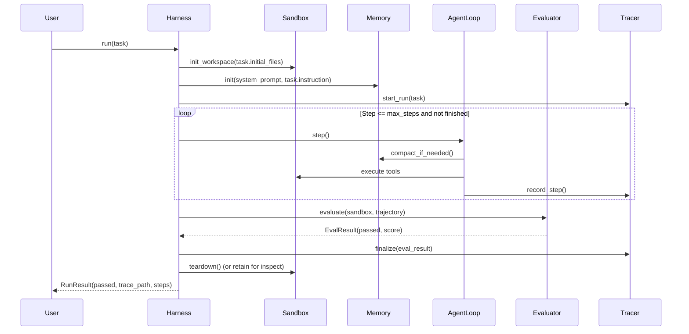

# Mini-Harness: Specification (SPEC)

## 1. Executive Summary & Philosophy
**Mini-Harness** is an educational, minimalist, and fully pluggable AI agent harness written in modern Python. Its primary purpose is to clearly demonstrate core agentic paradigms that are often obscured by complex frameworks (e.g., LangChain, AutoGen).

### Guiding Principles
1. **Simplicity over abstraction**: Clear, readable Python code leveraging standard library dataclasses and `typing.Protocol`.
2. **Strict separation of concerns**:
   * The **Agent Loop** is purely the thought-action-observation engine.
   * The **Harness** is the chassis providing environment sandboxing, budgets, telemetry/tracing, and evaluation.
3. **Pluggability**: Models, Tools, Evaluators, and Compaction strategies implement clean interfaces.
4. **Resilience & Pragmatism**: Realistic handling of massive command outputs (head/tail truncation + disk spillover) and context compaction.

---

## 2. Architecture & Directory Structure

```
mini-harness/
├── SPEC.md                  # This specification
├── core/
│   ├── types.py             # Data models (Message, ToolCall, Task, Trajectory, RunResult)
│   ├── environment.py       # Isolated workspace sandbox & bash runner
│   ├── tools.py             # Tool protocol + built-in tools (bash, read_file, write_file)
│   ├── memory.py            # Context manager & compaction strategies
│   ├── model.py             # Pluggable model interface (Direct API & MockModel)
│   ├── tracer.py            # Structured tracing (JSON + Markdown console output)
│   ├── loop.py              # Pure ReAct loop (~25 lines)
│   ├── evaluator.py         # Pluggable evaluators (File assertions & Test runner)
│   └── harness.py           # Harness orchestrator (Setup -> Run -> Evaluate -> Teardown)
└── main.py                  # Runnable educational examples
```

---

## 3. Component Specifications

### 3.1 Data Contracts (`core/types.py`)
```python
@dataclass
class ToolCall:
    id: str
    name: str
    arguments: dict[str, Any]

@dataclass
class Message:
    role: str  # "system" | "user" | "assistant" | "tool"
    content: str
    tool_call_id: Optional[str] = None
    tool_calls: Optional[list[ToolCall]] = None

@dataclass
class ToolResult:
    call_id: str
    output: str
    exit_code: int = 0
    was_truncated: bool = False
    raw_log_path: Optional[str] = None

@dataclass
class Task:
    id: str
    instruction: str
    system_prompt: Optional[str] = None
    initial_files: dict[str, str] = field(default_factory=dict)
    max_steps: int = 15
    timeout_seconds: float = 60.0

@dataclass
class StepTrace:
    step_index: int
    prompt_messages: list[dict]
    model_response: dict
    tool_results: list[dict]
    compaction_applied: bool = False
    duration_s: float = 0.0

@dataclass
class EvalResult:
    passed: bool
    score: float
    feedback: str
```

---

### 3.2 Environment Sandboxing (`core/environment.py`)
* **Workspace Isolation**: Each run creates a dedicated temporary directory (`/tmp/mini-harness/<run_id>/`).
* **File System Operations**: Reading and writing scoped strictly to the sandbox directory to prevent accidental host mutations.
* **Command Execution**:
  * Runs subprocesses with `cwd=sandbox_dir`.
  * Enforces per-command timeout.
  * Captures combined `stdout` and `stderr`.

---

### 3.3 Tool System & Large Log Handling (`core/tools.py`)
The tool protocol defines `name`, `description`, `parameters` (JSON Schema), and `execute(**kwargs)`.

#### Built-in Tools
1. `bash(command: str)`: Executes bash in the sandbox directory.
2. `read_file(path: str, start_line: int = 1, end_line: int = -1)`: Reads whole files or specific line slices.
3. `write_file(path: str, content: str)`: Writes/overwrites files inside the workspace.

#### Handling Massive Command Outputs (Spillover + Head/Tail Truncation)
When a command outputs excessive text (e.g. `> 4,000` characters or `> 100` lines):
1. **Spill to Disk**: The full, unedited output is saved to `.logs/step_<N>_<cmd>.log` inside the workspace.
2. **Head + Tail Truncation**: Only the first $1/3$ and last $2/3$ of the character allowance are fed to the LLM.
3. **Explicit Pointer**: The LLM receives a notice:
   ```
   [Output truncated from 84,200 chars. Full output saved to .logs/step_2_pytest.log]
   [Use 'grep' or 'read_file' to inspect specific sections if needed]
   ```
4. **Full Trace Recording**: The raw log path and untruncated content remain preserved in the `StepTrace`.

---

### 3.4 Context & Memory Management (`core/memory.py`)
Agent trajectories can quickly exceed the model's context window. `Memory` maintains the message list and executes compaction policies:

1. **Immediate Truncation**: Handled at tool observation time (Section 3.3).
2. **Context Window Compaction (Deferred Pruning)**:
   * **Trigger**: When estimated token count or total character count exceeds `max_context_chars` (e.g., 20,000 chars).
   * **Preservation Policy**:
     * System prompt is **never** pruned.
     * Task instruction (first user message) is **never** pruned.
     * The last $K$ turns (recent context) are kept intact.
   * **Compaction Target**: Older tool observations in middle turns are replaced with concise tombstone markers:
     ```
     {"role": "tool", "content": "[Output of bash('ls -la') collapsed to conserve context]"}
     ```

---

### 3.5 Pluggable Model Interface (`core/model.py`)
```python
class ModelProtocol(Protocol):
    def generate(self, messages: list[Message], tools: list[dict]) -> tuple[str, list[ToolCall]]:
        ...
```
* **`DirectAPIModel`**: Direct HTTP / OpenAI-compatible API caller (`/v1/chat/completions`) supporting OpenAI, DeepSeek, Ollama, Groq, or Anthropic (via proxy/compat).
* **`MockModel`**: A deterministic scripted model for offline CI, educational walkthroughs, and zero-cost unit testing.

---

### 3.6 Tracing & Debugging (`core/tracer.py`)
The `Tracer` captures every interaction:
* **`trace.json`**: Machine-readable log of full state at every step (inputs, model outputs, raw tool results, execution durations).
* **`trace.md`**: Human-readable terminal output and markdown summary showing thoughts, actions, observations, and evaluation status.

---

### 3.7 The Agent Loop (`core/loop.py`)
The loop is intentionally minimal (~25 lines of Python). It receives a `model`, `memory`, `tools`, and `tracer`, repeating:
```python
while not done:
    prompt_snapshot = memory.get_messages()
    response_text, tool_calls = model.generate(prompt_snapshot, tools)
    memory.add_assistant(response_text, tool_calls)

    if not tool_calls:
        break  # Agent finished reasoning

    for tool_call in tool_calls:
        result = tools.execute(tool_call)
        memory.add_tool_result(result)
```

---

### 3.8 Evaluator & Harness Orchestrator (`core/evaluator.py`, `core/harness.py`)

#### Evaluation
* **`FileContentEvaluator`**: Checks whether specific files exist and match regex or substring conditions.
* **`CommandTestEvaluator`**: Executes a validation command (e.g., `pytest tests/`) in the environment; exit code 0 indicates success.

#### Harness Lifecycle


---

## 4. Dependencies
* **Core**: Python 3.10+ Standard Library only (`dataclasses`, `typing`, `pathlib`, `subprocess`, `tempfile`, `json`, `urllib.request`).
* **Optional**: `pytest` for running sample evaluations.
